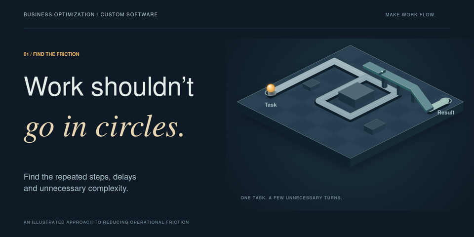
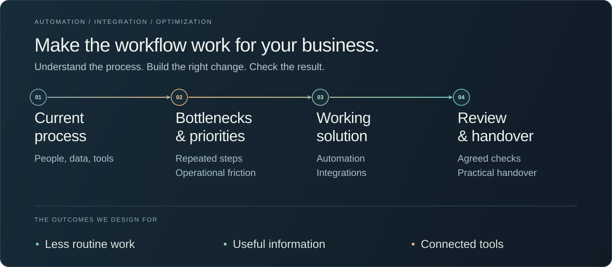
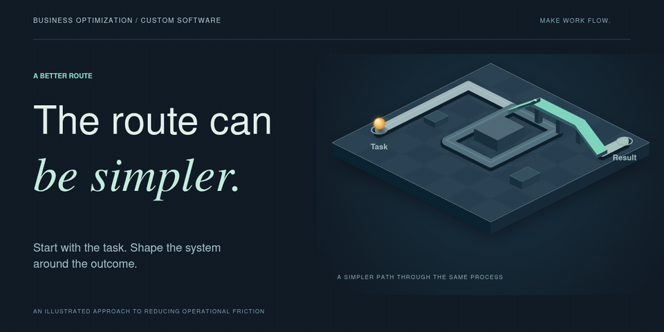

# Business Optimization & Custom Software

**Tell me what slows your business down. I map the workflow and build the systems it needs.**

The problem might be repeated work, scattered information, missing functionality, a process full of workarounds, or an idea that needs its own software.

I help businesses across industries turn these problems into practical improvements: simpler workflows, connected tools and custom applications built around how the business operates.

[Remove bottlenecks](#remove-bottlenecks) · [Build missing tools](#build-the-missing-tools) · [Connect your business](#connect-the-business)

## Remove Bottlenecks

Look at how work moves between people, information and tools. Find the repeated steps, delays and unnecessary complexity, then choose the changes worth making first.

The solution can combine workflow redesign, automation and improvements to existing systems. We agree on what a better process should do and how to check the result.

## Build the Missing Tools

Turn a business need into working software: a custom application, internal tool, interface, dashboard, backend or service.

From requirements and design through implementation and review, the software is shaped around its users, operating rules and practical constraints.

## Connect the Business

Bring existing applications, data sources and operating processes into a connected workflow. Make information available where it is needed and let actions move between the tools involved.

This can include integrations, shared data flows, reporting and automation across departments or services, with a useful way for your team to see and manage the work.

## From Problem to Working Solution

We agree on the goal, workflow and first scope, then build, review and refine the solution. You receive the working software or improvements and practical operating information.

<strong>Show a better route</strong>

A visual metaphor for simplifying a workflow.

The technology follows the job: custom code, existing platforms, APIs, databases and cloud integrations, including **Google Cloud** and **AWS** where appropriate.

[See an operations automation example](examples/operations-automation.md)

## Start with What You Want to Improve

Describe what you want to improve, the tools involved and the result you need. We can define a first paid milestone with clear deliverables and review criteria.

[Discuss a project on Upwork](https://www.upwork.com/freelancers/~01d554f7011bd884f2) · [Connect on LinkedIn](https://www.linkedin.com/in/tim-izmailov-a53524283/)
