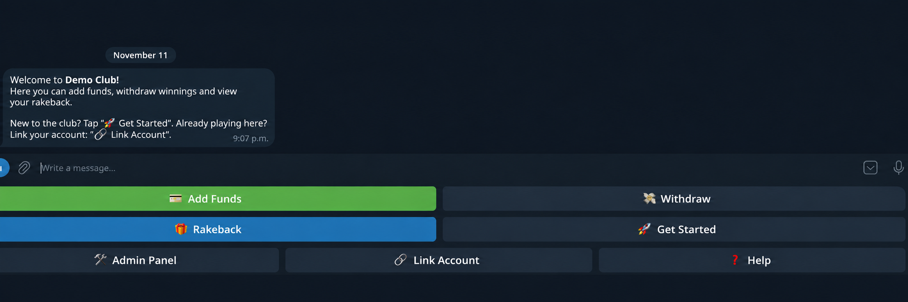
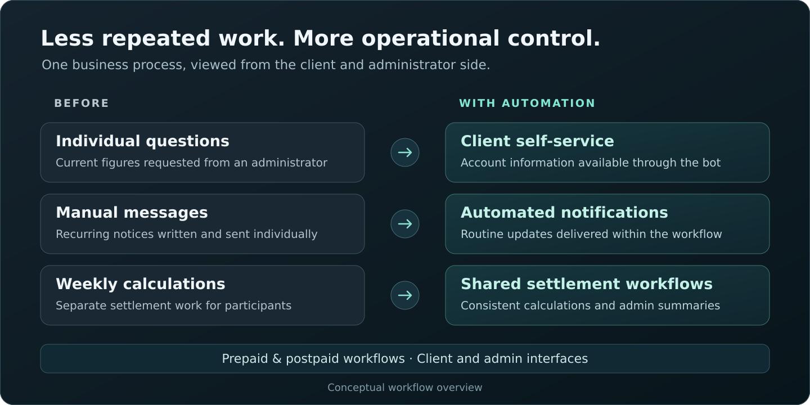
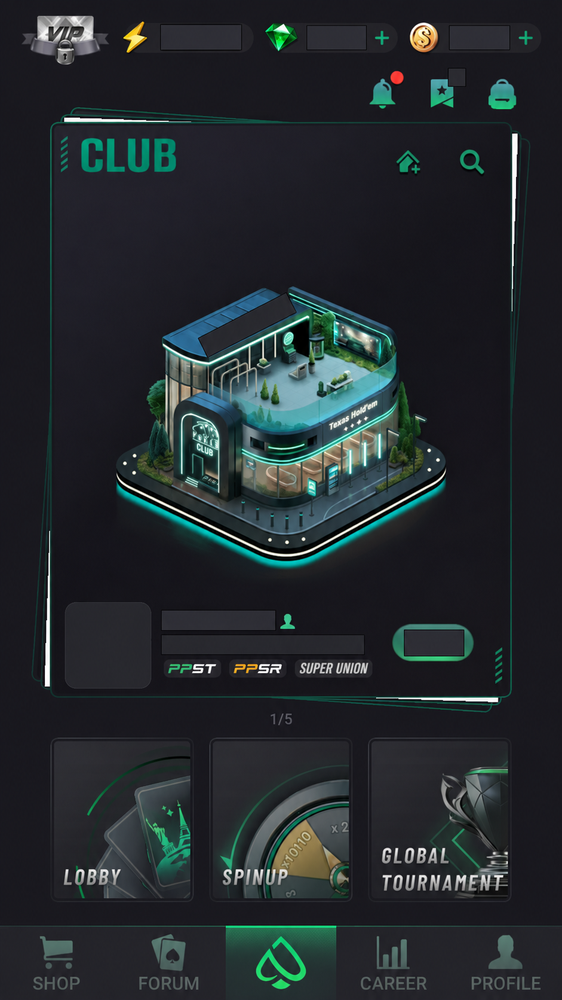
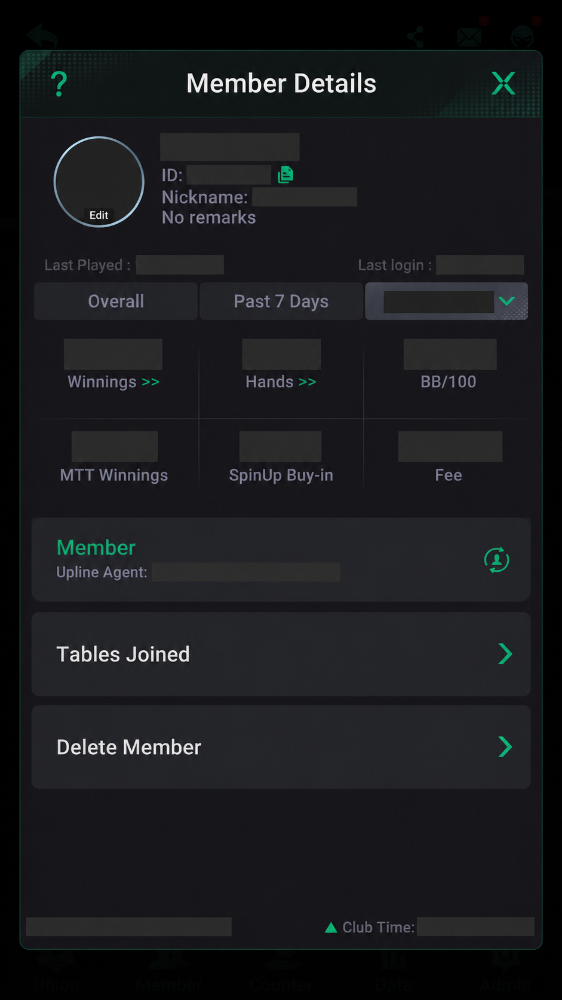

# Operations Automation — Project Example

A practical example of custom software built around an operating process.

[Back to Business Optimization & Custom Software](../README.md)

## The Business Problem

A poker-club operator was supporting around **50 players with activity around the clock**. Players needed up-to-date figures, the administrator answered their questions individually, and notifications were written manually.

Weekly settlement involved calculations for players, agents, and the operator. According to the client, this work occupied **an entire Monday**. Increasing the number of players would also increase the amount of manual administration.

I developed a system that brings these recurring operations into a shared service with dedicated client and administrator interfaces. Both prepaid and postpaid bot implementations are complete and ready for customer onboarding.

## The Client Interface

*The custom Telegram interface. Identifying details have been anonymized and the visible text translated into English for this portfolio presentation.*

The client can access account-related actions from one place: add funds, request a withdrawal, view rakeback, link an account, and get help. The administrator has a separate set of operational controls.

## Workflow in Action

| Previous manual process | Implemented capability |
| --- | --- |
| Players ask the administrator for their current figures | Client access to account information and calculations through the bot |
| The administrator writes recurring notifications individually | Automated notifications within the operational workflow |
| Weekly calculations are prepared separately for players, agents, and the operator | Automated settlement calculations and administrative summaries |
| Prepaid and postpaid operations require different handling | Dedicated workflows for both operating models |
| More players mean more repeated administrative work | A shared service with configurable club workflows |

The purpose is to let clients get routine information directly and give the operator a consistent place to manage the business. The implementation removes repeated work from the process and provides a foundation for expansion.

## What I Built

- **Client and administrator interfaces:** Telegram workflows for account information, operations, settings, and support.
- **Business calculations:** player balances, rakeback, and settlement logic for the participants involved in running a club.
- **Data integration:** collection of operational information from the existing source application and storage in a shared database.
- **Notifications:** automated delivery of routine operational messages.
- **Two operating models:** prepaid and postpaid bots with workflows suited to each model.
- **Server deployment:** a shared Python service supporting separate club interfaces and configurations.

### External System Integration

The automation works with information from an existing application. These screens show the source environment and the types of member statistics involved.

| Club interface | Member statistics |
| --- | --- |
|  |  |

*These are screenshots of the third-party source application, PPPoker. They illustrate the integration context; that application's interface was not developed by me. Club details, member identities, and values have been redacted.*

## My Contribution

I owned the work from requirements to implementation: translating the client's operating rules into workflows, developing the bots and data integration, implementing calculations, connecting the database, and preparing server deployment and handover.

**Stack:** Python · aiogram · PostgreSQL · Linux server deployment

**Delivery stage:** both bot implementations are complete. Customer onboarding and the transfer of day-to-day operations are the next stage.

The production code, customer data, and business-specific configuration remain private. This repository presents the completed development work and its business context.

[Discuss a different process on Upwork](https://www.upwork.com/freelancers/~01d554f7011bd884f2)
